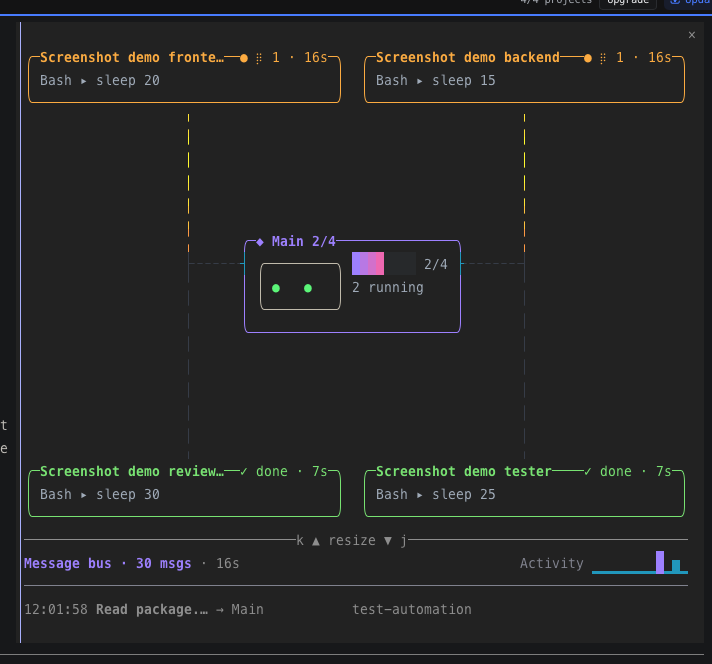
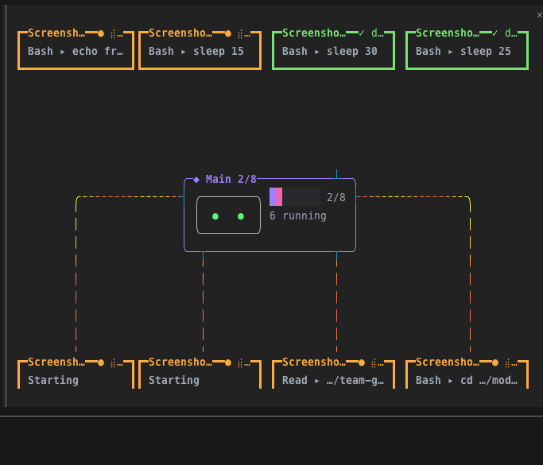
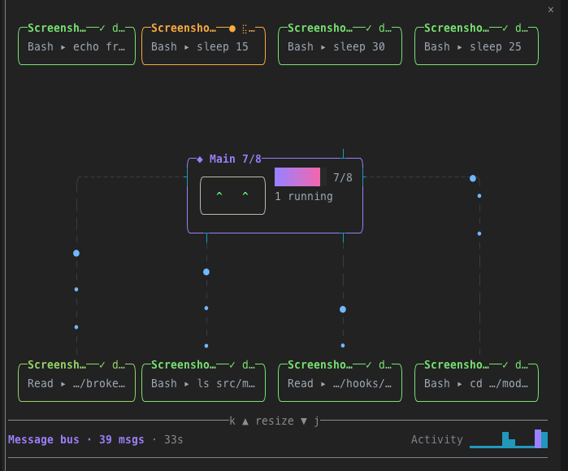
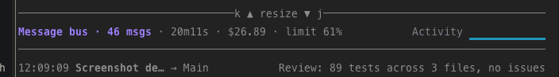
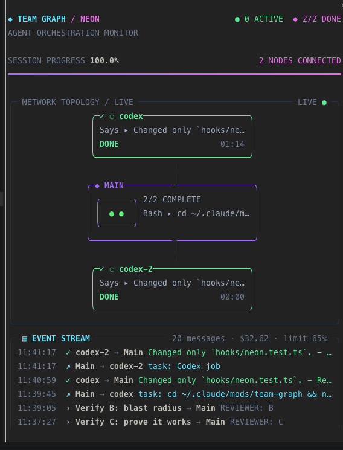
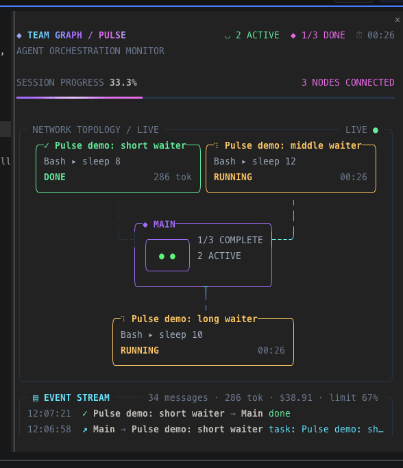

# Team Graph

A Claude Code plugin with a live terminal graph of your session's agents.
The orchestrator sits in the middle, agent boxes surround it, and a message
bus shows their communication and recent activity.

## Screenshots

Retro theme, four subagents: two running, two done, with the progress bar,
the robot head and the message bus.



Eight agents in two rows, six still running.



The run almost finished: the head's `^ ^` eyes, and message flights travelling
to Main.



The bus title with the `--tokens` and `--limits` extras: the session cost and
the busiest rate-limit window, next to the message count and run time.



Neon theme (`/team-graph --theme neon`): header with active and done counts, the session
progress bar, status-coloured cards round the orchestrator, and the event stream.



Pulse theme (`/team-graph --theme pulse`): neon with motion while agents run, with spinners on
working cards, a scrolling title gradient, a shimmer across the progress bar and glowing borders.



## Features

- Claude Code teams and subagents, including live tmux teammate activity.
- Codex jobs and other AI CLIs launched through Bash: Gemini, OpenCode, Amp,
  Kimi, Copilot, and `claude -p`.
- Classic, retro, neon and pulse themes; retro includes an animated robot head and gradient progress bar, neon a cyberpunk dashboard, pulse the same dashboard with more motion.
- Message flights, completion flashes, per-agent timers, and an activity sparkline.
- A 400 ms graph sweep, a 600 ms completion colour fade, and flowing hue on running lines.
- Persisted visibility, theme, robot style, motion, and graph height. Idle effects stop updating.
- Resize controls with `k` / `j` in the docked view; automatic layout sizing.
- "Needs you" alerts, tokens and cost, failure reasons, and rate-limit use, each
  switchable with a flag.
- Job discovery in `$TMPDIR`, `/private/tmp`, and `/tmp` on macOS and Linux.

## Cost

The mod uses no tokens. It never calls a model or an API: it runs inside
Claude Code as a normal program, reads local files (team configs, job logs in
`$TMPDIR`) and runs `id`, `tmux` and `tail`. It adds nothing to your prompts
or tool results. The only text that reaches the conversation is the one-line
reply to a `/team-graph` command, such as `Team graph shown.`

The `--tokens` and `--limits` extras only display numbers Claude Code already
reports; reading them costs nothing.

## Requirements

- Claude Code with hooks modules enabled. This API is experimental and may be
  gated or unavailable in your build/account.
- Optional: tmux for split teammates and live pane activity.
- Optional: the Codex plugin for Codex background job logs. Foreground AI CLI
  launches also appear without it.

## Install

1. Clone the repo into a folder for your Claude Code mods:

   ```sh
   git clone https://github.com/Quisui/team-graph.git ~/.claude/mods/team-graph
   ```

2. Tell Claude Code to load plugins from that folder. Add this to the `env`
   block of `~/.claude/settings.json` (create the block if it is missing). The
   folder can hold several mods; each subfolder is loaded as its own plugin:

   ```json
   {
     "env": {
       "CLAUDE_CODE_PLUGIN_DIRS": "~/.claude/mods"
     }
   }
   ```

3. Start a new Claude Code session, or run `/reload-plugins` in an open one.
   The graph opens on its own; `/team-graph` hides or shows it.

To try it once without changing settings, point a single session at the folder:

```sh
claude --plugin-dir ~/.claude/mods/team-graph
```

**Update:** `git -C ~/.claude/mods/team-graph pull`, then `/reload-plugins`.

**Uninstall:** delete `~/.claude/mods/team-graph` (and the `env` entry if no
other mod uses it), then `/reload-plugins`.

## Use

```text
/team-graph
/team-graph --theme classic
/team-graph --theme retro
/team-graph --theme neon
/team-graph --theme pulse
/team-graph --pulse light
/team-graph --robot head
/team-graph --robot plain
/team-graph --rows 17
/team-graph --motion off
/team-graph --motion on
/team-graph --needs off
/team-graph --tokens off
/team-graph --reasons off
/team-graph --limits off
```

Four extras are on by default; each has its own `on|off` flag and the choice
persists:

| Flag | Shows |
|---|---|
| `--needs` | An agent waiting on a permission dialog: its box turns yellow with `⚑ needs you`, the head says `⚑ 1 needs you`, and a toast fires once. Claude Code reports no "dialog answered" event, so the flag clears when that tool call returns: an approved long command keeps it until the command ends. In `auto`, `dontAsk` and `bypassPermissions` modes no dialog appears, so no flag shows, except for a plugin's ask or a question/plan tool. A custom agent whose definition sets its own `permissionMode` is judged by its parent's mode. |
| `--tokens` | Tokens per finished agent (`✓ done · 7s · 12k tok`), plus the run's total tokens and the session cost in the bus title. |
| `--reasons` | A failed agent's box shows its last answer line instead of its last tool. |
| `--limits` | The busiest rate-limit window in the bus title (`limit 42%`), when your plan reports one. |

The pane opens by default in a new session. `/team-graph` toggles it, and a
hidden pane stays hidden across sessions. Theme selection also shows a hidden pane.
`--rows` sets docked graph height (11 to 40); automatic height remains the default.
`--motion` persists your preference without toggling visibility. Motion is on
by default. Motion automatically stops when the pane viewport has fewer than
20 rows or `NO_MOTION` is set in the environment (read once at startup).
`--motion on` restores the preference; automatic reduction still takes priority.
With motion disabled, sweep-in, completion fades, hue flow, spinners, message
movement, and robot animation stop. Working eyes stay static (`●   ●` for
`head`, `[•_•]` for `plain`); completed eyes remain `^   ^`. Agent activity and
status still update. Below 70 columns, labels shorten, names truncate with `…`,
and the head's eyes move closer (`● ●`). Below 40 columns or 9 rows, the head
uses a single-line fallback such as `[● ●] 2 running` (the plain robot has no
track). Agent statuses use `●` running, `✓` done, `✗` failed/killed, and `○`
pending or idle before starting. A Codex or other AI CLI job that was killed or
interrupted ends as `stopped`, not failed. A run with failures ends with
`Done · N failed` instead of `All done`. Message age uses
three brightness levels: newest normal, middle dim, oldest dimmer.

`retro` is the default theme (state colours, gradient progress bar, robot head); `classic` colours each agent instead.
`neon` stacks a header (active, done, elapsed), the session progress bar, the graph with
status-coloured cards and cyan links, and an event stream. Narrow panes, or teams too large for
readable cards, show the agents as a list. The resize keys sit on its last row. The theme choice
is kept for new sessions.
`pulse` is neon with more motion while agents run: spinner frames from cli-spinners on
working cards and the active count, a scrolling cyan→violet→magenta title, a shimmer across
the progress bar, glowing borders on working cards and the orchestrator, a faster blink on
cards that need you, fading message trails, and new stream lines that arrive white and settle.
With motion off (or `NO_MOTION`, or a short pane) it draws exactly like neon.
`--pulse full` (the default) keeps every pulse effect moving at the fast rate even when no agent
runs; `--pulse light` moves fast only while agents run and slows to a 150 ms tick when idle.
The choice is kept for new sessions.

`--robot head|plain` selects and persists the retro robot without toggling
visibility; `--robot=head` also works. `head` is the default: a rounded white
outline with two mint-green eyes beside the progress bar and running count.
Working eyes (`●   ●`) glance slowly and blink every few seconds; a message
landing on Main or Orchestrator triggers a quick double blink. Completed eyes
are `^   ^`, idle/no-agent eyes are dim grey `−   −`, and a failed agent with
nothing running gives red `×   ×` eyes. Motion reduction disables glancing and
blinking. `plain` keeps the original `[•_•]` walking track and `\[^_^]/ All done`
cheer. Classic rendering is unaffected.

Theme aliases: `-t retro`, `--theme=retro`, or a bare `retro` / `classic` / `neon` / `pulse`.
Use `k` to shrink the graph and `j` to grow it when the resize divider appears.
The fullscreen layout puts the bus beside the graph; narrower layouts put it below.

## Checks

Run from this folder:

```sh
claude plugin validate .
claude plugin test .
```

If the test runner reports hooks modules are turned off, enable them in a
supported Claude Code environment before relying on test results.

MIT licensed. See [LICENSE](LICENSE) and [CREDITS.md](CREDITS.md).
